# SQLens documentation

**Watch your data transform.**

SQLens shows what a SQL query does to your tables while you write it. As you type, the tables you are using light up: the columns you pick, the rows your filter removes, and the new columns you are building. When you run the query, the app goes through it one stage at a time and explains each stage in plain words.

It is made for anyone who finds it hard to picture what a query is doing, including people with aphantasia. You can open this guide at any time from **Documentation** in the toolbar at the top of the window. **Open online** at the top of the guide opens the same pages in your web browser.

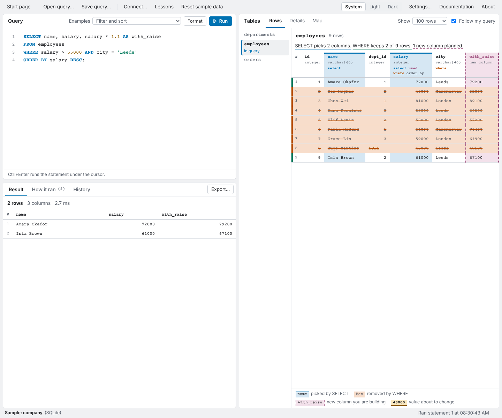

## Install the app

### Windows

1. Open the project's [Releases page](https://github.com/dtb1000/SQLens/releases) and download the newest file called `SQLens-Setup-<version>.exe`.
2. Double-click the file. Windows may show a blue box that says "Windows protected your PC", because the app is not signed by a paid certificate yet. Click **More info**, then **Run anyway**.
3. The app installs for your Windows account only, so it does not ask for an administrator password. It adds **SQLens** to the Start menu and the desktop.

To remove it, open **Settings > Apps > Installed apps**, find SQLens and choose **Uninstall**.

### macOS and Linux

There is no installer for these yet. You can run the app from its source code, as described in the project's README.

## The start page

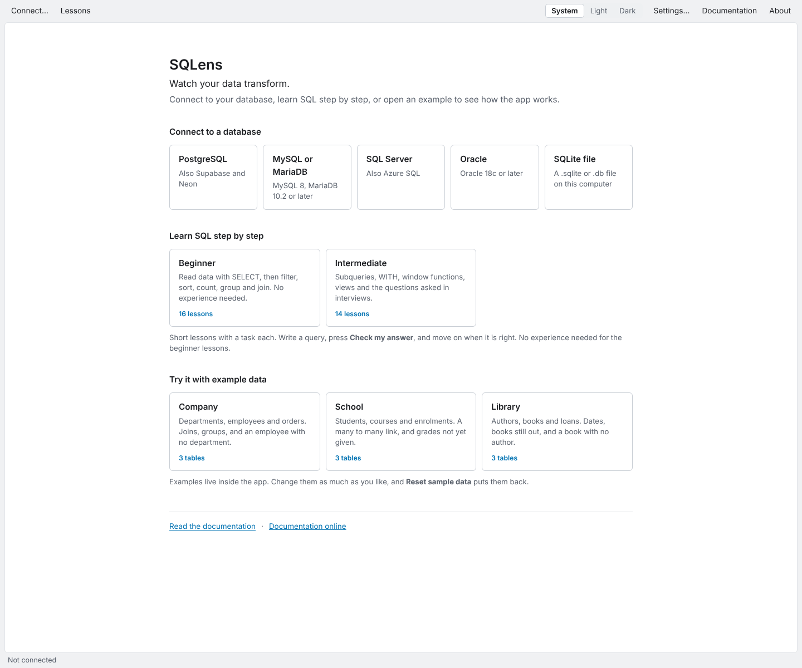

The app opens on the start page. It has three parts.

- **Connect to a database** has one tile for each kind of database: PostgreSQL, MySQL or MariaDB, SQL Server, Oracle, and a SQLite file. Click one to open the connection window with that database already chosen. Connections you have used before are listed under **Recent**. Click one to fill in its details again. You only need to type the password.
- **Learn SQL step by step** starts the lessons. **Beginner** starts from nothing, and **Intermediate** follows on from it. Each tile shows how many lessons you have finished, and clicking it opens the next one you have not done. The lessons are described further down this guide.
- **Try it with example data** opens a small example database inside the app, with ready-made queries to try. **Company** has departments, employees and orders. **School** has students, courses and enrolments, a many to many link. **Library** has authors, books and loans, with dates and books still out. Each one opens with its first example already run. The examples are described near the end of this guide.

At the bottom are links to this documentation, inside the app and online. To come back to the start page later, click **Start page** in the toolbar.

## The window

The window has a toolbar along the top, three areas, and a status line along the bottom.

| Area | Where | What it shows |
| --- | --- | --- |
| Toolbar | top | **Start page**, **Open query…**, **Save query…**, **Connect…**, **Lessons**, **Reset sample data**, the **System**, **Light** and **Dark** switch, **Settings…**, **Documentation** and **About**. |
| Query | top left | Where you type SQL. Line numbers are on the left. |
| Output | bottom left | **Result** shows what your query returned. **How it ran** walks through it one stage at a time. **History** lists the queries you have run. |
| Tables | right | The tables your query uses, loaded live, first 100 rows (or up to 1000). They change as you type. **Details** describes each column, and **Map** shows how the tables link. |
| Status line | bottom | Which database you are connected to, when you last ran a statement, and the version of the app. The version is also in the window title. |

You can make any area bigger by dragging the gap between two areas. A thin blue line shows when you point at the gap. Double-click it to put the sizes back.

## Learn SQL with the lessons

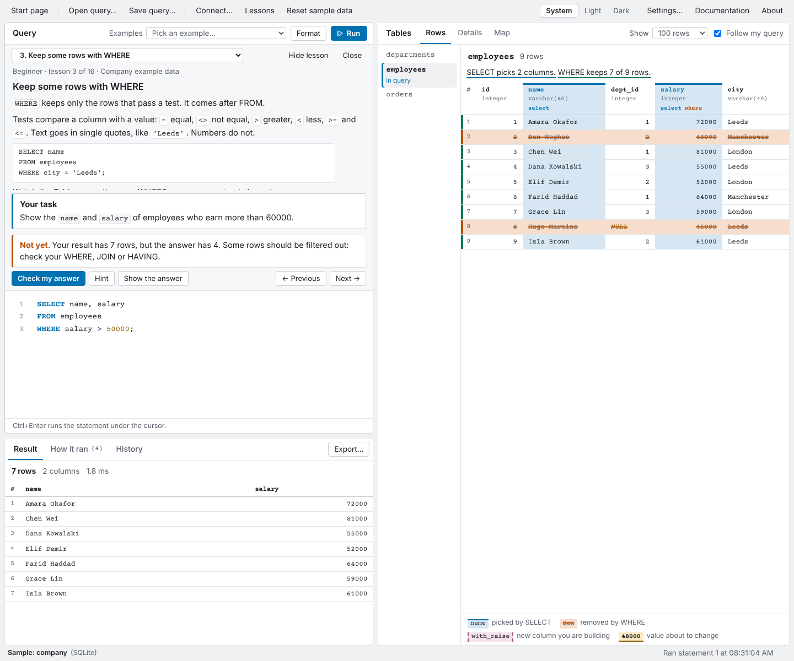

The lessons teach SQL from the first `SELECT` to the kind of questions asked in interviews for entry-level data and analyst jobs. You need no experience to start. Each lesson explains one idea with a short example, then gives you a task to solve on one of the example databases. The lessons build on each other, so do them in order the first time.

To start, click a tile under **Learn SQL step by step** on the start page, or click **Lessons** in the toolbar. The lesson appears above your query, and the app opens the example database the lesson uses.

### Do a lesson

1. Read the explanation. If it is long, scroll it. The example in grey is there to copy and change.
2. Read **Your task**. It always stays in view.
3. Write your query in the Query area. The live tables work as usual, so you can watch your columns light up and your filtered rows get struck out while you type.
4. Click **Check my answer**. The app runs your query and the lesson's own answer on the same data and compares the two results.

If your result matches, the lesson is marked done and a **Next lesson** button appears. If it does not, the message says what is different, for example "Your result has 7 rows, but the answer has 4", and where to look. The table under the message shows your result, so you can compare it with what the task asked for.

A message that starts with **Nearly** means your result is right but the lesson wanted you to practise something you did not use, such as `BETWEEN`. Try writing it that way.

### When you are stuck

- **Hint** gives a small nudge. Click it again for a bigger one.
- **Show the answer** shows one correct query, laid out for reading. **Put it in the Query area** copies it there so you can run it and look at how it ran. It is worth trying the next lesson without it.

The order of rows does not matter unless the task says to sort. The order of columns does not matter either, though the app tells you if yours differ from the task. Column names only matter when the task asks for a name, for example "call it `total`".

### Lessons that change data

A few lessons ask you to insert, update or delete rows, or to create a view. For these, **Check my answer** puts the example data back the way it was, runs your statements, and compares what the tables hold afterwards with what the answer would give. You can try as often as you like. **Reset sample data** in the toolbar also puts the data back.

### Move between lessons

Use the list at the top of the lesson to jump to any lesson. Finished lessons have a tick. **Previous** and **Next** step through them in order. **Hide lesson** folds the lesson away to give the Query area more room, and **Close** leaves the lessons. Your progress is saved on this computer, so you can stop and carry on another day.

### Beginner lessons

All of these use the Company example, apart from the three table join, which uses School.

1. Choose columns with SELECT and FROM
2. All columns, and naming columns with AS
3. Keep some rows with WHERE
4. Combine tests with AND, OR and brackets
5. Shortcuts: IN, BETWEEN and LIKE
6. Empty values: NULL
7. Sort with ORDER BY, and keep the first rows with LIMIT
8. Remove repeats with DISTINCT
9. Count and add up: COUNT, SUM, AVG, MIN, MAX
10. One row per group: GROUP BY
11. Filter groups with HAVING
12. Combine two tables with JOIN
13. Keep rows with no match: LEFT JOIN
14. Three tables, and a many to many link
15. Choose a value with CASE
16. Change data: INSERT, UPDATE and DELETE

### Intermediate lessons

These use all three example databases.

1. A query inside a query
2. Name a step with WITH (a CTE)
3. Several steps in a row
4. Number rows in groups: ROW_NUMBER and PARTITION BY
5. Running totals
6. Compare with the row before: LAG
7. Group totals on every row
8. Interview classic: the top earner in each group
9. COUNT(*) or COUNT(column) after a LEFT JOIN
10. Fill in missing values: COALESCE
11. Group by month
12. Stack results: UNION, INTERSECT and EXCEPT
13. Save a query as a view
14. Put it together

The lessons are also written out in [the tutorials](tutorials.md), with one answer to each task, so you can read them away from the app.

After both tracks, a good next step is to connect to a real database you know, or a public one, and answer your own questions about it. **How it ran** is there to check that each stage does what you expect.

## Write and run a query

Type your query in the Query area. Keywords such as `SELECT` and `WHERE` turn blue, text in quotes turns green, numbers turn orange and comments turn grey.

To run it, press **Ctrl + Enter** (on a Mac, **Cmd + Enter**), or click **Run** at the top right of the Query area.

You can keep several statements in the Query area at once, as long as each one ends with a semicolon (`;`). Run only runs the statement your cursor is in. When there is more than one statement, the one under your cursor gets a faint blue background, and the line under the Query area says which statement it is, for example "Statement 2 of 3 is under the cursor".

**Examples**, at the top of the Query area next to **Run**, holds ready-made queries for the example database you opened. Picking one puts it in the Query area and runs it straight away, and the menu then shows that example's name. Once you change the query, the menu goes back to **Pick an example…**, because the query is no longer the example as written. This menu only appears while you are using an example database.

Each example database has examples of `WITH` (also called a CTE, a common table expression) and of a view:

- **`WITH`** gives a small query a name, so the main query can use it like a table. It only lasts for that one query. The How it ran tab shows each named part as its own stage, "Make dept_pay (WITH)", before the main query uses it.
- **A view** is a query saved in the database under a name, with `CREATE VIEW name AS SELECT ...`. After that, you can use the name in `FROM` like a table, and the saved query runs again each time, so a view always shows the current data. A view appears in the table list like a table. The view examples run three statements in turn: `DROP VIEW IF EXISTS` (so the example can be run again), `CREATE VIEW`, and a `SELECT` that uses the view. To remove a view, run `DROP VIEW name;`.

What you type is kept when you close the app, and comes back the next time you open it. To keep a query as a file, click **Save query…** in the toolbar. **Open query…** loads a `.sql` file into the Query area. Ctrl + Z undoes it if you change your mind.

### Suggestions as you type

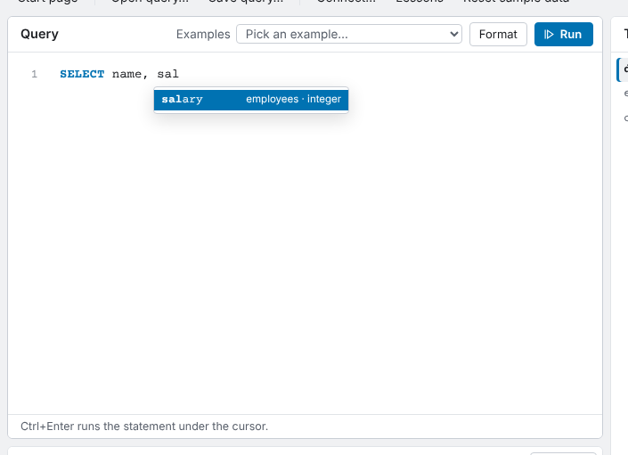

As you type, a list opens under the cursor with names that fit:

- After `FROM`, `JOIN`, `INTO` or `UPDATE`, it lists your tables.
- After a table name or its short name and a dot, such as `e.`, it lists that table's columns.
- Anywhere else, it lists the columns of the tables in your query, then keywords and common functions such as `COUNT` and `ROUND`.

Each suggestion says what it is, for example "employees · integer" for a column. If what you typed is close to a real name but not quite right, such as `emploees`, the list offers the real name with the note **did you mean?**

Use the up and down arrows to move through the list, and **Enter** or **Tab** to put the suggestion in. **Esc** closes the list. **Ctrl + Space** opens it on demand. If you would rather it only opened with Ctrl + Space, change **Suggestions** in Settings.

### Make a query easier to read

Click **Format**, or press **Shift + Alt + F**, to lay out the whole Query area neatly: each clause on its own line, one column per line when there are several, each `AND` and `OR` condition on its own line, keywords in capitals, and subqueries indented. It only changes spaces, line breaks and capital letters, never what the query does. Ctrl + Z puts it back.

```sql
SELECT
  d.name AS department,
  COUNT(*) AS people
FROM employees e
JOIN departments d
  ON e.dept_id = d.id
WHERE
  e.salary > 50000
  AND e.city = 'Leeds'
GROUP BY d.name
```

## Read the live tables

The Tables area updates a moment after you stop typing. You do not need to run anything.

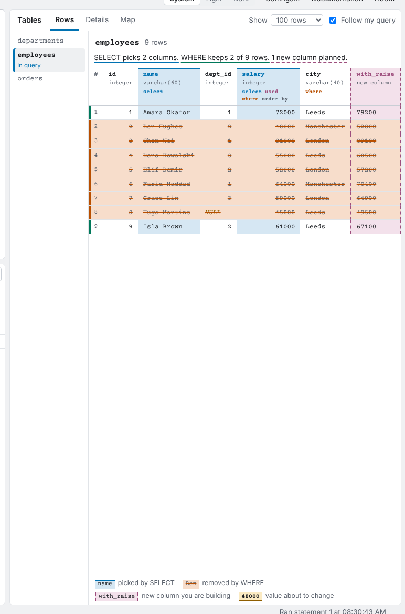

The list on the left of the area shows every table in the database. Tables your query uses say *in query* next to their name. **Follow my query** is at the top right of the area. While **Follow my query** is ticked, the area shows every table your query uses, one under the other. Click any table name to look at that table instead. This turns **Follow my query** off. Tick it again to go back.

**Show** at the top of the area sets how many rows each table loads: 100, 500 or 1000. More rows take a little longer to update as you type.

Above each table, a short line sums up what your query will do to it, for example "WHERE keeps 2 of 9 rows". Each part is underlined in the colour of the mark it describes.

The table itself is marked like this. A key along the bottom of the area shows each mark on a sample value. Every mark has a second cue besides colour, so it can be read without telling colours apart.

| What you see | What it means |
| --- | --- |
| Blue column, with a blue line at its top | `SELECT` picks this column for the result. |
| Row struck through, with an orange-red edge on the left | `WHERE` will remove this row. |
| Green edge on the left of a row | `WHERE` keeps this row. |
| Column with dashed purple sides, at the far right | A new column you are building, such as `salary * 1.1 AS with_raise`. It is already filled in with the values it will have. |
| Orange cell, underlined | `UPDATE` is about to change this value. |
| Struck-through orange-red row | `DELETE` is about to remove this row. |
| *NULL* in orange italics | The cell is empty (`NULL`). |

Under each column heading, small words say how the query uses that column:

| Word | Meaning |
| --- | --- |
| select | The column is in the result. |
| used | The column is used to work out a new column. |
| where | The column is used in a filter (`WHERE` or `HAVING`). |
| join | The column is used to match rows between tables. |
| group by | The column is used in `GROUP BY`. |
| order by | The column is used in `ORDER BY`. |
| set | `UPDATE` will write to this column. |

A new column that uses `COUNT`, `SUM`, `AVG`, `MIN` or `MAX` is shown with the note "one value per group" or "one value for all rows", because it has no value for a single row. A new column that mixes two tables shows "needs the join first", because its values only exist once the tables are joined.

### Look up what a column holds

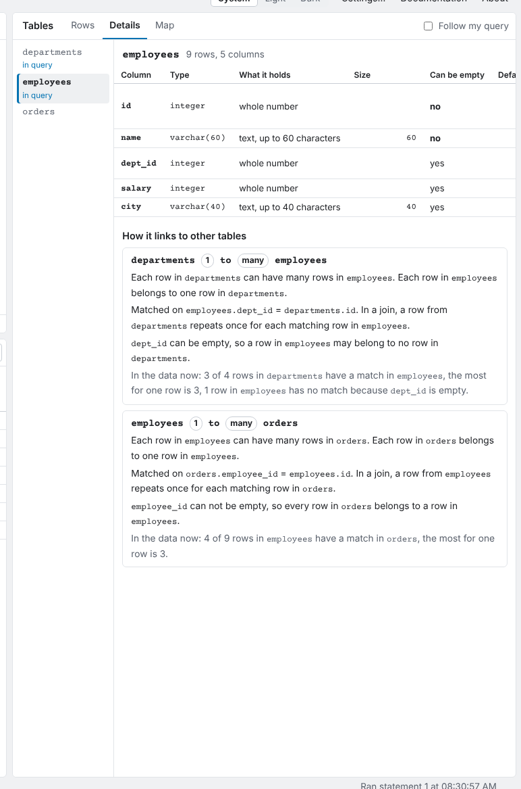

Click **Details** at the top of the Tables area. Pick a table from the list on the left, or leave **Follow my query** ticked to see the tables your query uses. Each column of the table gets one line:

| Heading | What it tells you |
| --- | --- |
| Column | The column's name. |
| Type | The type exactly as the database names it, such as `varchar(60)` or `decimal(10,2)`. |
| What it holds | The same thing in plain words, such as "text, up to 60 characters", "whole number" or "exact number, up to 10 digits with 2 digits after the point". |
| Size | The longest text the column takes, or for exact numbers the number of digits and the digits after the point. Blank when the type has no size. |
| Can be empty | **no** means every row must have a value. **yes** means the column can be `NULL`. |
| Default | The value the database fills in when you add a row and leave this column out. |
| Key | **key** marks the primary key, the column that tells rows apart. **unique** means no two rows can share a value. "links to departments.id" means the column points at a row in another table, and "used by employees.dept_id" means another table points at this column. |

Under the columns, **How it links to other tables** explains each link in words, the same way as under the map (see the next section). It also counts real rows, for example "3 of 4 rows in departments have a match in employees, the most for one row is 3". For tables with more than 200,000 rows the counts are left out, so the view stays quick.

### See how the tables link

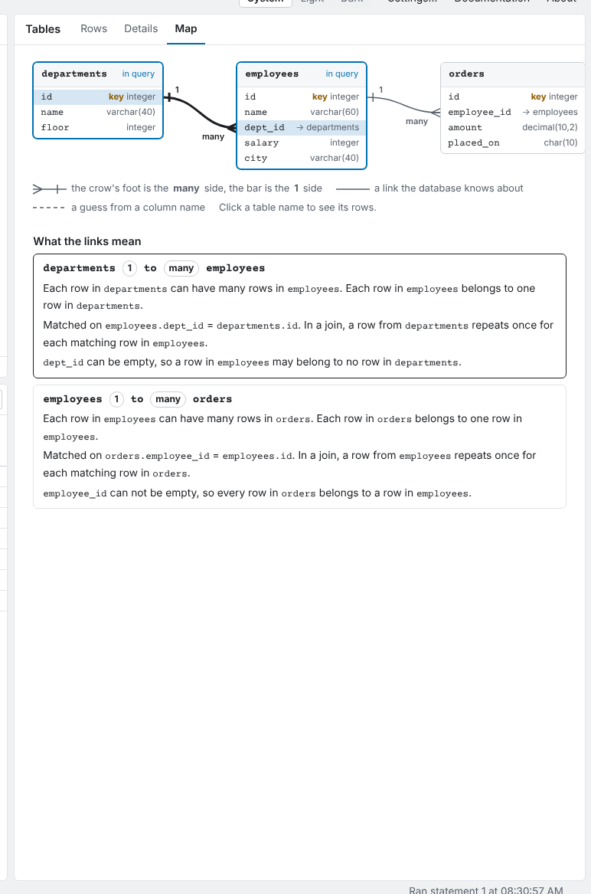

Click **Map** at the top of the Tables area to see every table as a box with its columns. A line joins a column that points at another table to the column it points at. For example, `employees.dept_id` points at `departments.id`.

Each end of a line shows how many rows can be on that side:

- The **crow's foot** (three short prongs) and the word **many** sit on the *many* side. Many rows in that table can point at the same row on the other side. Many employees can share one department.
- The **bar** and the word **1** sit on the *one* side. Each row on the many side points at only one row here. Each employee has one department.
- If the pointing column can hold each value only once (it is unique), both ends show a bar and **1**. That is a one to one link.

The other marks on the map:

- A solid line is a link the database knows about (a foreign key).
- A dashed line is a guess, made when a column is named like another table plus `_id`, such as `employee_id`. The column says "(guessed)".
- A column that points at another table shows an arrow and that table's name, such as "→ departments".
- A column marked **key** is the table's primary key.
- Tables your query uses have a blue edge and say *in query*. When your query joins two tables on a link, that line is drawn in blue.

Under the map, **What the links mean** says what each link means in plain words, for example:

> **departments 1 to many employees.** Each row in departments can have many rows in employees. Each row in employees belongs to one row in departments. Matched on employees.dept_id = departments.id. In a join, a row from departments repeats once for each matching row in employees. dept_id can be empty, so a row in employees may belong to no row in departments.

The sentence about joins is the one to keep in mind when writing a query. Joining from the one side to the many side gives one result row per row on the many side, so values from the one side repeat. A row on the many side with an empty link column has no match, and drops out of an inner join. Point at a sentence to light up its line on the map.

Click a table name in the map to see its rows. Click **Rows** to go back.

## See how a query ran

After you run a `SELECT`, open the **How it ran** tab under the Query area. The number in brackets next to the tab says how many stages there are.

A database does not read a query in the order it is written. You write `SELECT` first, but the database starts with `FROM`. The stages are shown in the order the database really uses:

**FROM, JOIN, WHERE, GROUP BY, HAVING, SELECT, ORDER BY, LIMIT**

Only the stages your query uses are shown. They appear as a numbered line of stops, and the one you are on is underlined. Click a stop to see that stage, or use **Back** and **Next**. While your cursor is not in the Query area, the left and right arrow keys also move between stages. **Play all** goes through every stage by itself, one every few seconds. **Show every step at once** puts all the stages on one long page.

Every stage has a heading, the part of your query it belongs to, a short explanation, and the rows at that point.

### Read the tables

The first stage shows each table named in `FROM` and `JOIN`, with its number of rows. When there is more than one table, each row gets a label so you can follow it: rows of the first table are L1, L2 and so on, rows of the other table are R1, R2 and so on.

### Join

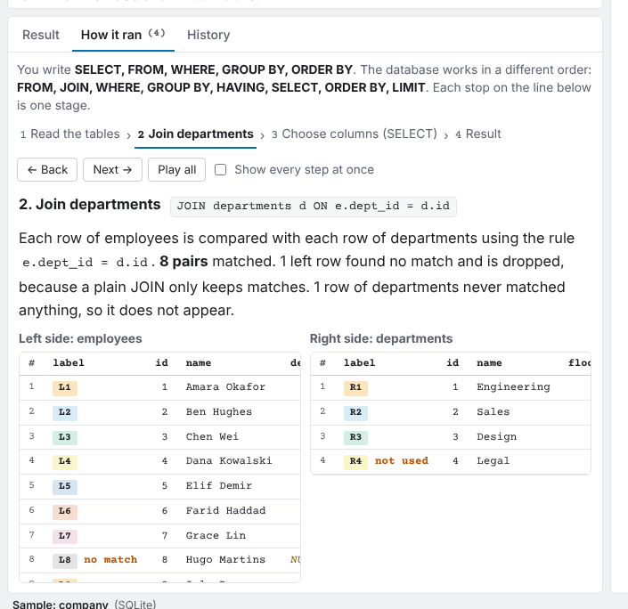

The join stage shows the left table, the right table and the joined rows. Each joined row starts with its two labels, so "L3 R1" means row 3 of the left table was matched with row 1 of the right one. The explanation says how many pairs matched, which rows found no match, and what the kind of join does with them:

- `JOIN` (also called `INNER JOIN`) keeps only rows that matched. Left rows with no match are marked **no match**.
- `LEFT JOIN` keeps every left row. Where nothing matched, the right side is filled with `NULL`.
- `RIGHT JOIN` and `FULL JOIN` keep unmatched rows from the right, or from both sides.
- A comma between tables, or `CROSS JOIN`, pairs every row with every row.

Right rows that never matched anything are marked **not used**.

### WHERE

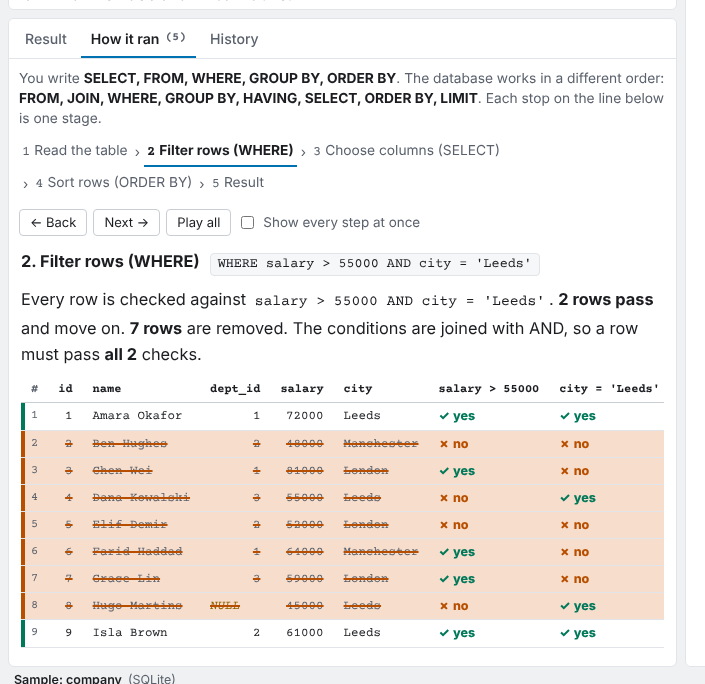

Each row is checked against the condition. Rows that pass get a green edge. Rows that fail are struck through. The columns at the right show the answer for each row: **✓ yes**, **✗ no**, or **? unknown**.

When the condition is made of several parts joined with `AND`, each part gets its own column, so you can see which part a row failed.

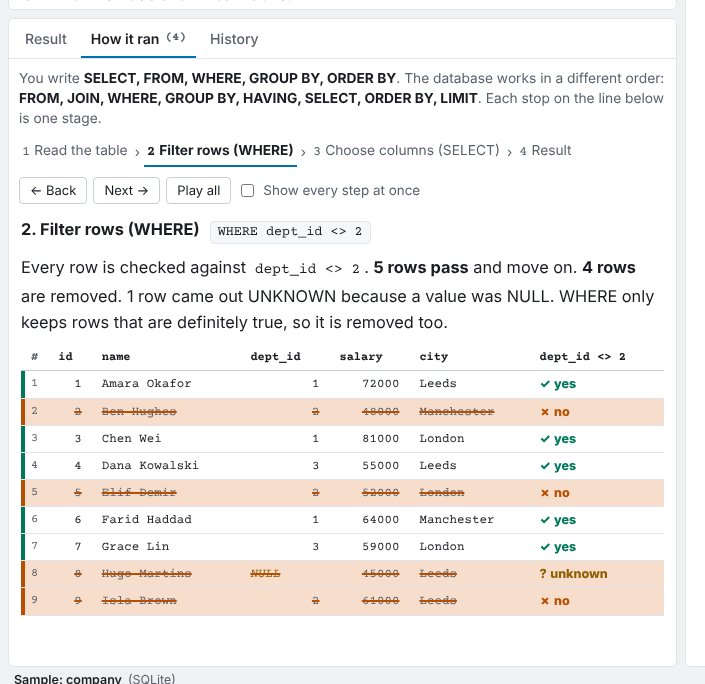

A comparison with an empty value (`NULL`) is neither true nor false, so it comes out as **? unknown**. `WHERE` only keeps rows that are definitely true, so unknown rows are removed too. In the sample database, Hugo has no department, so `WHERE dept_id <> 2` removes him, even though he is not in department 2. The example called "The NULL trap" shows this.

### GROUP BY

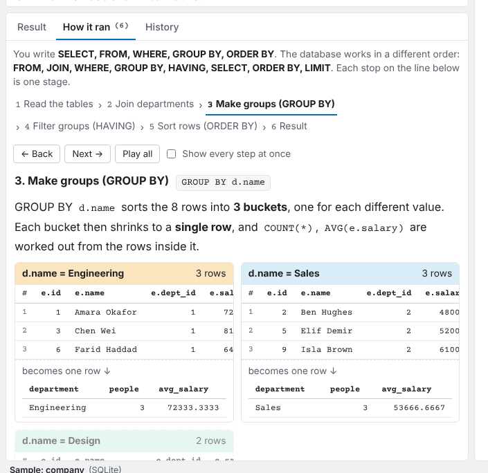

`GROUP BY` sorts the rows into buckets, one for each different value. Each bucket is drawn as a card with the rows inside it. Under each card, "becomes one row" shows the single row the bucket turns into, with the totals (`COUNT`, `SUM`, `AVG` and so on) worked out from the rows in that bucket.

If you use `COUNT`, `SUM` or similar without `GROUP BY`, all the rows go into one bucket and come out as one row.

### HAVING

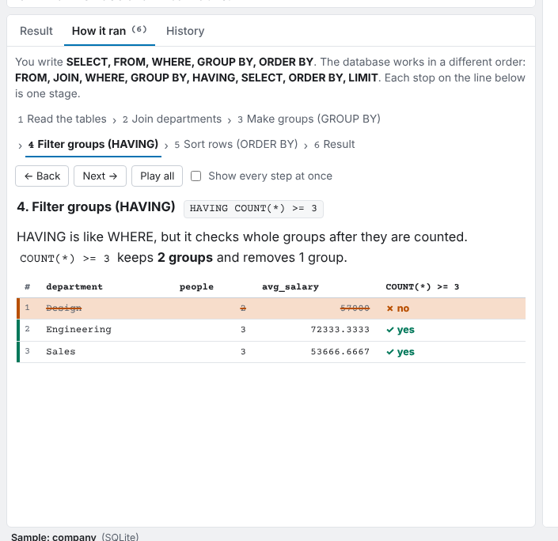

`HAVING` works like `WHERE`, but on the finished groups instead of single rows. Groups that fail are struck through. The same groups are also faded in the GROUP BY stage, with the note "Removed later by HAVING".

### SELECT

This stage shows the columns that end up in the result. The explanation lists which columns are kept, which new columns are built and from what, and which columns are renamed with `AS`. A new column's heading shows the formula it came from. With `DISTINCT`, it also says how many repeated rows were removed.

### ORDER BY

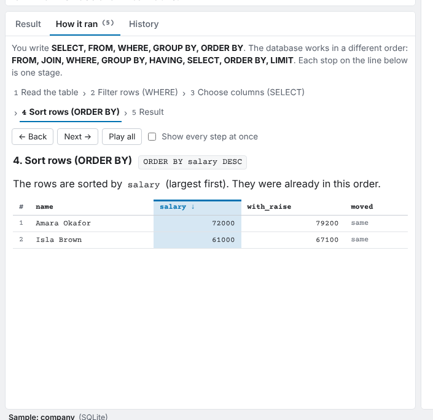

The rows are shown in their new order. The column you sort by is tinted blue and its heading has an arrow: ↓ for largest first (`DESC`), ↑ for smallest first (`ASC`). The **moved** column says where each row came from, for example "#3 → #1", or "same" if it did not move. Unless your computer is set to reduce motion, the rows also slide into their new places.

### LIMIT and OFFSET

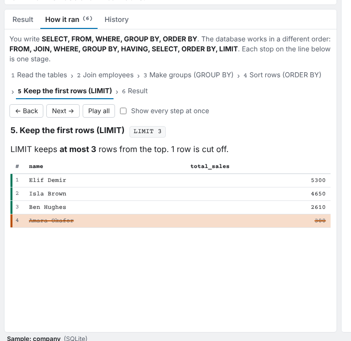

All the sorted rows are shown. The rows `LIMIT` keeps have a green edge, and the rows it cuts off are struck through. With `OFFSET`, the skipped rows at the top are struck through as well.

### Window functions

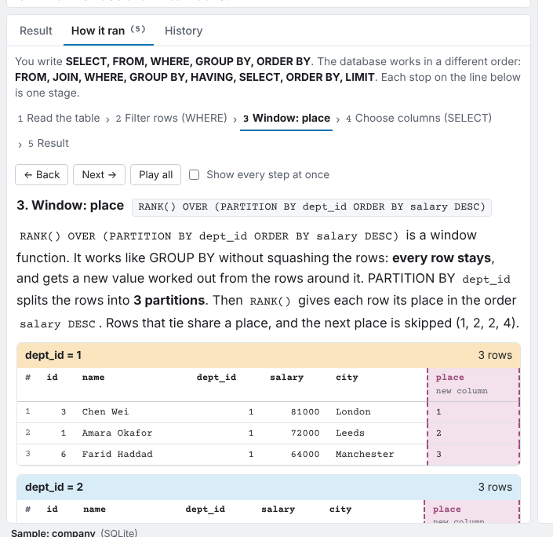

A window function has `OVER (...)` after it, such as `ROW_NUMBER() OVER (PARTITION BY dept_id ORDER BY salary DESC)`. It works like `GROUP BY` without squashing the rows: every row stays, and gets a new value worked out from the rows around it.

The stage shows the rows split into partitions, one box per value of `PARTITION BY`, each sorted by the window's `ORDER BY`. The new column, with dashed purple sides, holds the value each row gets. The explanation says what the function does, for example that `ROW_NUMBER` starts again at 1 in each partition, that `RANK` skips a place after a tie, or that `SUM(...) OVER (ORDER BY ...)` is a running total.

### Result

The last stage is the finished result, the same table as the Result tab.

### WITH

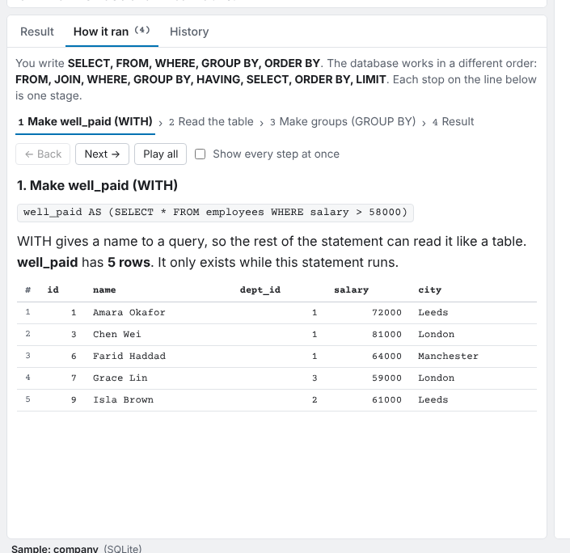

`WITH name AS (...)` gives a query a name, so the rest of the statement can read it like a table. Each named query gets a stage of its own first, showing its rows, and says if it reads from an earlier one. After that, the main query gets its usual stages, reading the named queries like tables.

For `WITH RECURSIVE`, the stage explains that the part before `UNION` makes the first rows, and the part after it runs again and again on the rows it just made, until no new rows appear.

### UNION, INTERSECT and EXCEPT

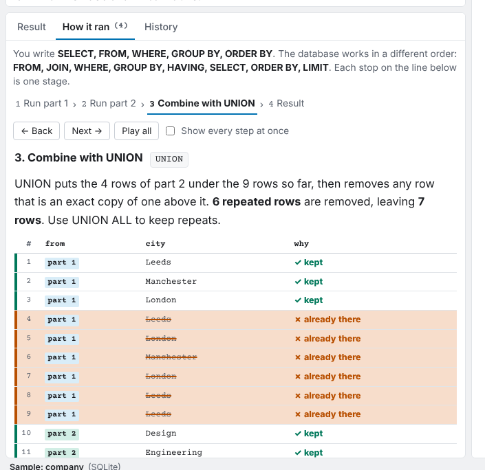

These join the results of two or more complete `SELECT`s. Each `SELECT` gets a stage of its own, called a part. Then a stage combines them, with a **from** column saying which part each row came from:

- `UNION ALL` puts the rows of the next part underneath. Nothing is removed.
- `UNION` does the same, then strikes through every row that is an exact copy of one above it ("already there").
- `INTERSECT` keeps only the rows that are in both.
- `EXCEPT` strikes through the rows that also appear in the next part.

An `ORDER BY` or `LIMIT` after the last part applies to the whole combined result, so it gets a stage of its own at the end.

## Change data

`INSERT`, `UPDATE` and `DELETE` are also shown before and after they run.

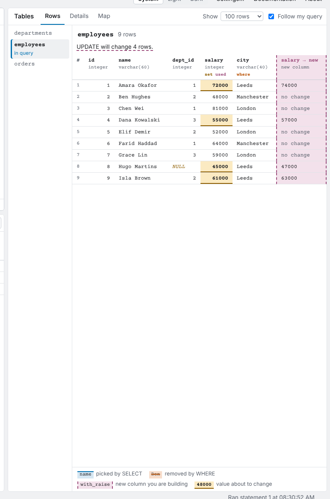

While you type an `UPDATE`, the Tables area marks the rows it will change and adds a column named after the changed column, such as "salary → new", with the new values. Rows that will not change say "no change". While you type a `DELETE`, the rows it will remove are struck through.

When you run the statement, **How it ran** shows three stages: the table before the change, the rows the `WHERE` picks, and the table after the change with the changed cells or new rows highlighted.

Running a statement changes the data for real, as in any SQL client. On the sample database, **Reset sample data** in the toolbar puts everything back the way it started. On your own databases there is no undo.

If a table has no primary key, the app cannot tell exactly which rows changed, so the last stage shows the table without highlights and says so.

## History

The **History** tab lists every statement you have run, newest first, with when it ran, which database, and how many rows it gave or the error. The search box filters the list.

**Put in the editor** adds the statement to the end of the Query area and puts the cursor in it, without removing what is there. **Run again** does the same and runs it. **Clear history** empties the list. The history is kept on your computer only, up to the last 300 statements.

## Export a result

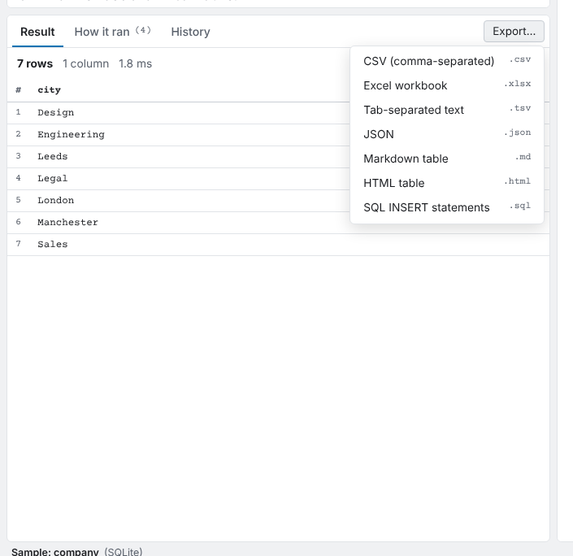

After a query runs, click **Export…** at the top right of the Output area and pick a format. The app asks where to save the file.

| Format | Good for |
| --- | --- |
| CSV | Almost any program. Opens in Excel with the right characters. |
| Excel workbook (.xlsx) | Excel, Numbers or LibreOffice, with a bold header row that stays put as you scroll |
| Tab-separated text | Pasting into other tools |
| JSON | Code and web tools |
| Markdown table | Notes and documentation |
| HTML table | A web page or an email |
| SQL INSERT statements | Copying the rows into another database |

Export saves **every** row of the result, not only the ones on the screen. After an `INSERT`, `UPDATE` or `DELETE`, it saves the changed table.

## Connect to your own database

Click **Connect…** in the toolbar.

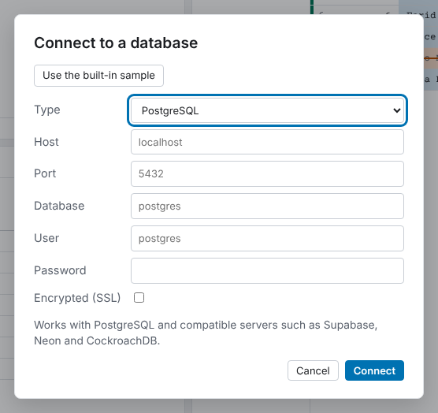

Choose the type of database, fill in the details and click **Connect**. If the connection fails, the window stays open and shows the message from the database.

| Type | What to fill in | Needs |
| --- | --- | --- |
| SQLite | A database file. Click **Browse…** to pick one. Leave it empty for the sample. A file name that does not exist yet creates a new, empty database. | Nothing else |
| PostgreSQL | Host, port (5432 if empty), database, user, password | Any recent version. Supabase, Neon and CockroachDB work the same way. |
| MySQL / MariaDB | Host, port (3306 if empty), database, user, password | MySQL 8 or MariaDB 10.2 or newer for the stages |
| SQL Server | Host, port (1433 if empty), database, user, password | SQL Server 2016 or newer, or Azure SQL |
| Oracle | Host, port (1521 if empty), service name in the Database box, user, password | Oracle 18c or newer for the stages |

Tick **Encrypted (SSL)** if your server needs an encrypted connection, which most cloud databases do.

The app remembers your last six connections, without their passwords, and lists them at the top of the Connect window so you can pick one again. Passwords are never saved.

To draw the stages, the app makes short-lived temporary tables on your connection and removes them when it is done. They are only visible to your own connection. The user you connect with needs permission to create temporary tables.

SQLite and PostgreSQL have been tested from start to finish. MySQL, SQL Server and Oracle are supported but have had less testing so far. Please report anything that looks wrong.

## The example databases

The examples live inside the app, so nothing you do to them affects anything else. **Reset sample data** in the toolbar puts the one you are using back the way it started.

### Company

| Table | Columns | Rows |
| --- | --- | --- |
| `departments` | `id`, `name`, `floor` | 4: Engineering, Sales, Design and Legal. Legal has no staff. |
| `employees` | `id`, `name`, `dept_id`, `salary`, `city` | 9. Hugo Martins has no department (`dept_id` is `NULL`). |
| `orders` | `id`, `employee_id`, `amount`, `placed_on` | 10 sales, made by four of the staff |

`employees.dept_id` points at `departments.id`, and `orders.employee_id` points at `employees.id`. Both are one to many links: one department has many employees, and one employee has many orders. Click **Details** in the Tables area to see each column's type and size.

### School

| Table | Columns | Rows |
| --- | --- | --- |
| `students` | `id`, `name`, `year`, `tutor` | 8. Two have no tutor yet. |
| `courses` | `id`, `title`, `credits`, `room` | 5. Nobody takes Networks. |
| `enrolments` | `student_id`, `course_id`, `grade` | 16. Two grades are not given yet (`NULL`). |

A student takes many courses, and a course has many students. A many to many link like this needs a table in the middle: each row of `enrolments` says one student takes one course. On the map it shows as two one to many links that meet at `enrolments`.

### Library

| Table | Columns | Rows |
| --- | --- | --- |
| `authors` | `id`, `name`, `country` | 5. One has no country. |
| `books` | `id`, `title`, `author_id`, `published`, `pages` | 8. One book has no author. |
| `loans` | `id`, `book_id`, `borrower`, `out_on`, `back_on` | 10. A loan with no `back_on` date is still out. |

`books.author_id` points at `authors.id`, and `loans.book_id` points at `books.id`.

## Keyboard shortcuts

| Keys | What they do |
| --- | --- |
| Ctrl + Enter (Cmd + Enter on a Mac) | Run the statement under the cursor |
| Shift + Alt + F | Format the Query area |
| Ctrl + Space | Show suggestions |
| Up and down arrows, then Enter or Tab | Pick a suggestion |
| Tab, in the Query area with no suggestions open | Insert two spaces |
| Ctrl + Z | Undo, also after Format, Open query or a suggestion |
| Left and right arrows | Previous and next stage, when the stages are showing and the Query area is not selected |
| Esc | Close the suggestions, the connection window, Settings or this guide |

## When something goes wrong

When the database cannot run a query, the Result tab shows a red-edged box. It starts with a plain explanation of the most common causes:

- **A table name is not recognised.** The box lists the tables that do exist.
- **A column name is not recognised.** Check the spelling, and whether the column needs its table name in front, like `e.name`.
- **Two tables have a column with this name.** Put the table name or its short name in front, like `e.name`.
- **COUNT, SUM, AVG and similar can not go in WHERE.** Use `HAVING` after `GROUP BY` instead.
- **Every selected column must be in GROUP BY or inside COUNT, SUM, AVG, MIN or MAX.**

Below that is the database's own message, word for word.

Some queries run and show a result, but their stages are not drawn yet: a window function in the same query as `GROUP BY`, and a window defined by name in a `WINDOW` clause. SQL Server's `TOP` and Oracle's `FETCH FIRST` also do not have a stage of their own yet. In these cases the How it ran tab says so and shows the result.

## Settings

### Light and dark

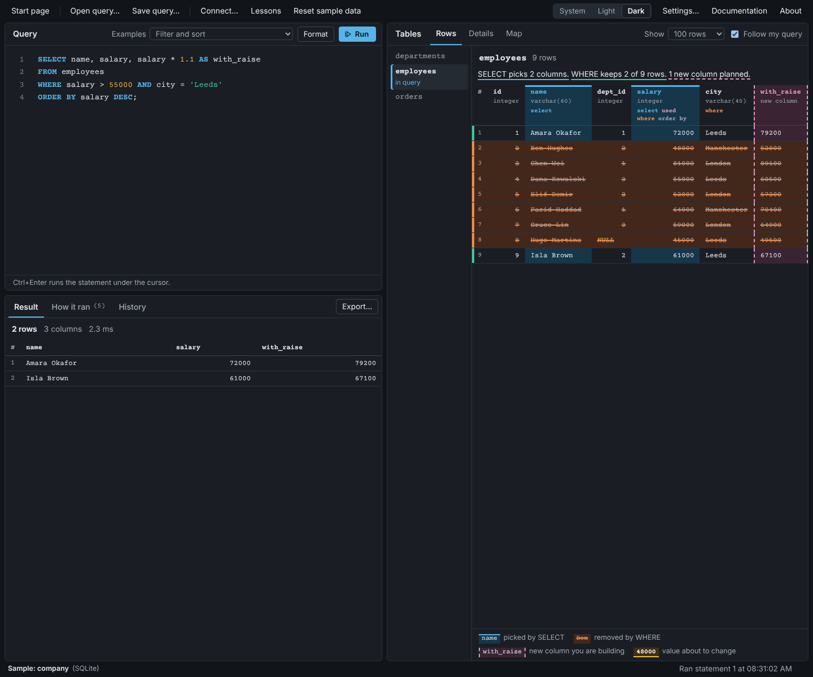

The three buttons next to **Settings…** in the toolbar choose how bright the window is. **System** follows the light or dark setting of your computer, and changes when your computer does, for example at sunset if Windows switches by itself. **Light** and **Dark** keep the window that way whatever the computer is set to. The title bar of the window follows your choice too. The choice is kept for next time.

Both looks use the same colour-blind safe colours, made a little brighter on the dark background, and every mark keeps its second cue. The high contrast versions are under **Colours** in Settings. When one of those is on, none of the three buttons is pressed. Pressing one of them goes back to the normal colours.

### All settings

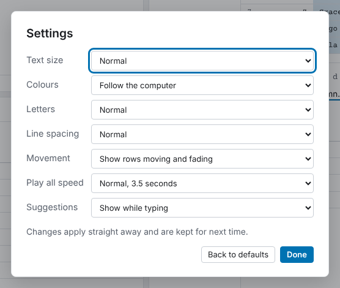

Click **Settings…** in the toolbar. Changes apply straight away and are kept for next time. **Back to defaults** undoes them all.

| Setting | Choices |
| --- | --- |
| Text size | Small, Normal, Large, Larger, Largest. Everything in the window grows, tables and code included. |
| Colours | Follow the computer's light or dark setting, Light, Dark (the same as the toolbar switch), High contrast light (black on white with darker colours and stronger lines), or High contrast dark |
| Letters | Normal, or wider spacing between letters and words |
| Line spacing | Normal, Relaxed or Loose. Applies to the explanations, the tables and the Query area. |
| Movement | Rows that slide and fade, or no movement at all |
| Play all speed | How long **Play all** stays on each stage: 6, 3.5 or 2 seconds |
| Suggestions | Open while typing, or only with Ctrl + Space |

The colours come from a palette made to stay distinct for people with the common kinds of colour blindness. Every colour mark also has a second cue: a strike-through, a dashed edge, a symbol or a word. If your computer is set to reduce motion, rows do not slide or fade whatever the Movement setting says. The text is set in Inter and the code in Courier Prime, a clearer version of Courier. Both are built into the app, so it looks the same with no internet connection.
